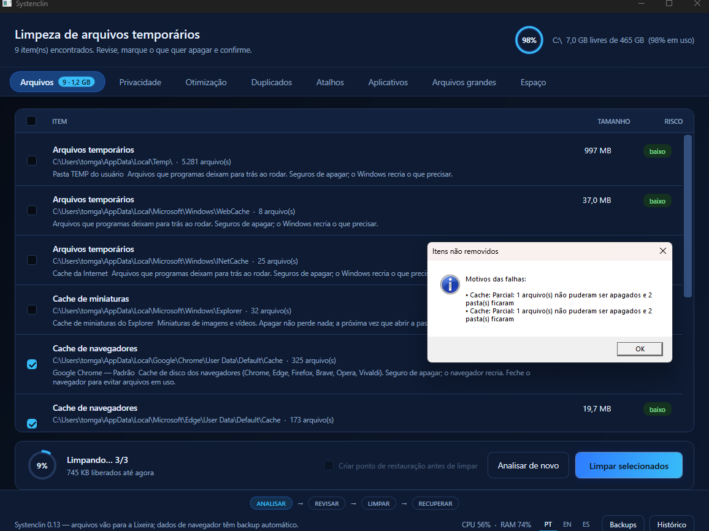
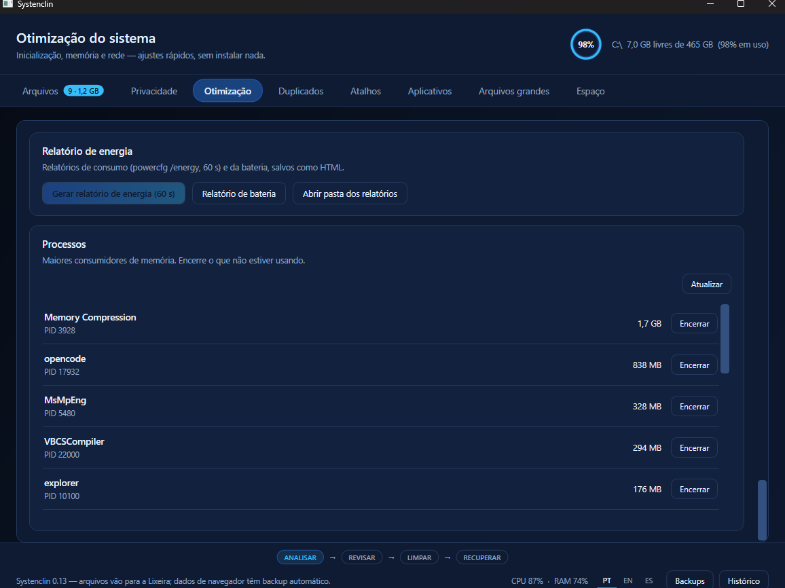
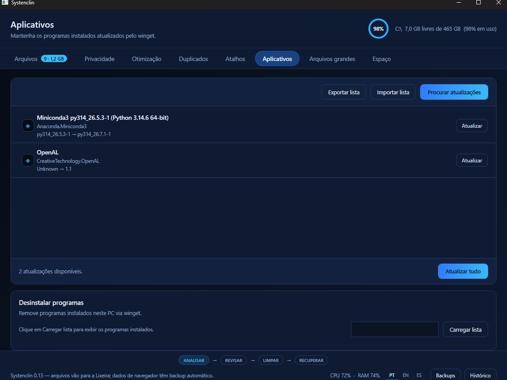
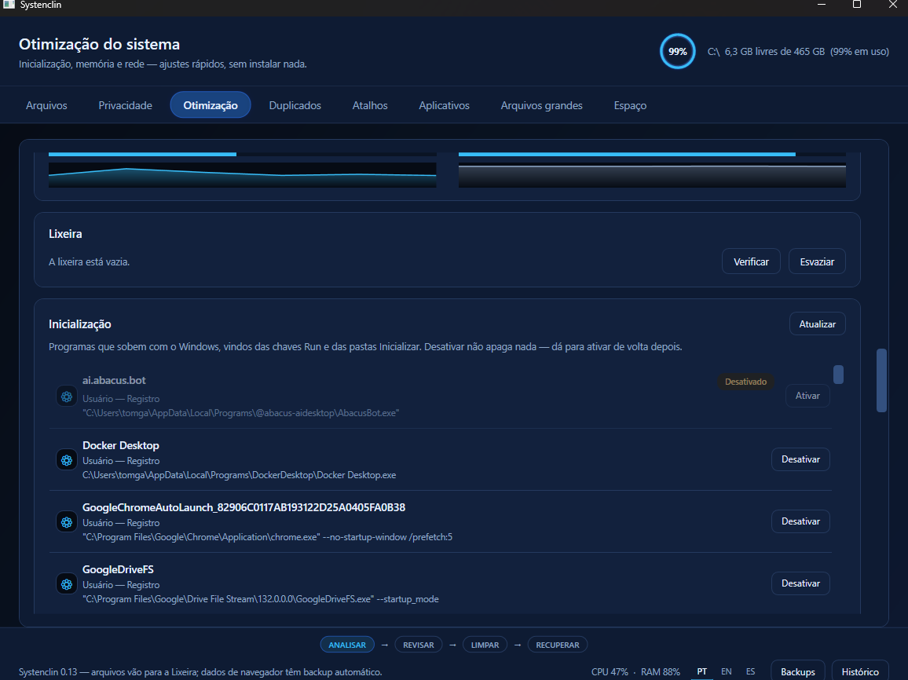
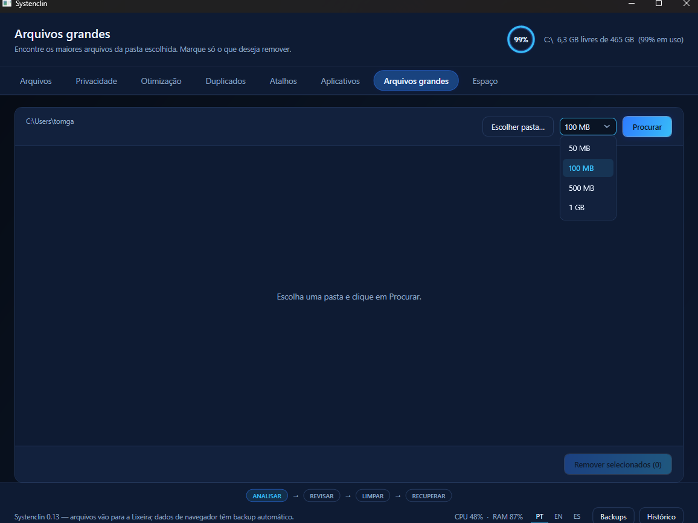

# Systenclin

[](https://github.com/lucbruna/SystenClin-/actions/workflows/ci.yml)

Windows cleanup and optimization. Built from scratch — **no code, assets, or branding reused**.



## Status

| Version | Module | Status |
|---|---|---|
| **v0.1** | Temporary file cleanup | ✅ done |
| **v0.2** | Browser privacy | ✅ done |
| **v0.3** | Startup manager | ✅ done |
| **v0.4** | Memory, DNS, processes, and live monitor | ✅ done |
| **v0.5** | Disk and space (optimization, duplicates, large files, folders) | ✅ done |
| **v0.6** | Applications: update and uninstall (winget) | ✅ done |
| **v0.7** | Restore point + undo (Recycle Bin, backups, history) | ✅ done |
| **v0.8** | Extras: broken shortcuts, recycle bin, status bar, 1-click boost, conservative network | ✅ done |
| **v0.9** | Windows tools: WinSxS, traces, secure delete, hardening, drivers, registry clean, scheduling, safe folder | ✅ done |
| **v0.10** | Disk health: SMART state + `chkdsk /scan` | ✅ done |
| **v0.11** | Language selection (PT/EN/ES) + application updates reworked | ✅ done |
| **v0.12** | Update progress you can actually see (bar + phases + elapsed) | ✅ done |
| **v0.13** | Power report, app-list backup/restore, local crash logs, automated releases | ✅ done |
| **v0.14** | Modern UI: navy/neon theme, circular gauges, cleanup pipeline, dark title bar | ✅ done |

## Run

```bash
cd Systenclin
dotnet run -c Release
```

Ready-to-run executable: `dist/Systenclin.exe` (≈ 930 KB + `e_sqlite3.dll`),
single file, requires the .NET Desktop Runtime 10.

Tagged releases (`v*`) are built and published automatically by
`.github/workflows/release.yml`: verification harness → publish → zip
(`Systenclin.exe` + `e_sqlite3.dll`) → SHA-256 → GitHub Release with generated
notes. Prebuilt zips: see
[Releases](https://github.com/lucbruna/SystenClin-/releases).

## Tests

```bash
cd Testes/Systenclin.Testes
dotnet run -c Release
```

**130 checks, 0 failures** (128 when elevated). The focus is on what can
dangerously go wrong, not pretty coverage. The harness compiles `Core/*.cs`
directly — no UI — and uses the desktop framework only for the boot-event
EventLog.

---

## v0.1 — Temporary files

**Scan** — read-only. Measures 16 known targets: TEMP, Windows Update cache,
thumbnails, error reports, NuGet/npm/pip caches, old logs.

**Cleanup** — files go to the **Recycle Bin** (recoverable). Cache folders are
removed for good, and the UI says so instead of promising undo that does not
exist.

### Safety rules (covered by tests)

1. **Never crosses junctions or symbolic links.** A junction in `%TEMP%`
   pointing to `C:\Windows` would make the cleaner delete Windows.
2. **9 protected areas**, checked during the scan **and again** at delete time.
3. **Rejects drive roots, shallow paths, and traversal** (`..`).
4. **High risk is never pre-checked.** Neither is the Recycle Bin.
5. **One failure does not stop the rest.** The reason gets logged.

---

## v0.2 — Browser privacy

Reads and cleans history, cookies, form data, downloads, permissions, cache,
and saved tabs from **Chrome, Edge, Firefox, Brave, Opera, and Vivaldi** —
every profile of each (on this machine: 8 profiles).

### What changes from v0.1

v0.1 measured bytes. Here **measuring is not enough** — the user must see what
is about to be deleted. Each item shows a readable preview:

```
Browsing history — Google Chrome — Default
  10/15/26 22:14  ×3   .NET documentation
      https://learn.microsoft.com/dotnet/...
  15/10/26 21:58  ×1   GitHub — systenclin
      https://github.com/...
```

### The three non-negotiables

**1. Browser closed for database data.**

There is no safe way to write to an open browser's SQLite file: it keeps state
in memory and overwrites, or corrupts the database. The app detects this and
**refuses**, telling you which browser to close. Products that promise
"cleaning with the browser open" either lie or corrupt data.

Cache and saved tabs are files on disk — those can be cleaned right now.

**2. Backup before deleting.**

Every database is copied to `%LOCALAPPDATA%\Systenclin\backup-privacidade\`
before any write. It is the only honest way to offer undo — v0.1 could not,
this one can. The **Backups** button lists them and explains how to restore.

**3. Whole category, never a single cookie.**

Half-measures leave users thinking they cleaned it when they did not.

### Reading with the browser open

The app reads even while Chrome and Edge are running, opening the file with
`FILE_SHARE_READ | FILE_SHARE_WRITE`. A plain `File.ReadAllBytes` would fail
with "file in use".

### Risks, stated clearly

| Data | Risk | Checked by default? |
|---|---|---|
| Browsing history | low | yes |
| Browser cache | low | yes |
| Download history | low | yes |
| Filled forms | medium | **no** |
| Saved tabs | medium | **no** |
| Site permissions | medium | **no** |
| **Cookies** | **high** | **no** |

Cookies sign you out of every account. The warning appears in the confirmation
dialog, in plain text, not hidden in a tooltip.

---

## v0.3 — Startup manager

View, disable, and re-enable what starts with Windows, from five sources: the
user `Run` key, the machine `Run` key (64- and 32-bit views), and both Startup
folders.

**Disabling loses nothing.** The original value — name, type, and data — is
written to `%LOCALAPPDATA%\Systenclin\inicializacao.json` **before** leaving
the registry (and the store is rolled back if the write fails). Startup folder
files are moved to `inicializacao_desativados`. Enabling undoes it through the
same saved path. Machine items require administrator, and the UI says so
instead of failing silently.

## v0.4 — Memory, DNS, processes, and monitor

- **Free memory** — trims the working set of processes above 20 MB.
- **Flush DNS cache** — direct flush.
- **Processes** — top 15 by memory; killing confirms with two clicks.
- **Live monitor** — CPU and RAM with 60 s history, in the Optimization tab
  and in the footer since v0.8. `GetSystemTimes` + `GlobalMemoryStatusEx`, no
  `PerformanceCounter`. Runs only while the window is open — nothing resident.

## v0.5 — Disk and space

- **Optimize disk** — detects SSD or HDD (volume seek penalty) and runs
  `defrag /O`: TRIM on SSDs, defragmentation on HDDs. Requires administrator.
- **Duplicates** — grouped by hash; checked ones go to the Recycle Bin.
- **Large files** — sorted by size; Recycle Bin.
- **Folder analysis** — what takes up space, folder by folder.

## v0.6 — Applications (winget)

Update (one or all) and uninstall via winget. Without winget, the UI explains
instead of throwing an error. Uninstall uses winget's own flow — nothing
silent. The update list is parsed structurally (columns read right to left),
so it survives winget's localized headers and column format changes.

## v0.7 — Restore and undo

- **Restore point** — optional, before cleaning, when running as administrator
  (the checkbox sits in the confirmation bar).
- **Layered undo** — files go to the Recycle Bin; browser data has backups in
  `%LOCALAPPDATA%\Systenclin\backup-privacidade\`; every operation lands in
  the **History** (`CleanLog`, JSON).

## v0.8 — Extras

- **Broken shortcuts** — `.lnk` files pointing to missing targets, on the
  Desktop and Start Menu; checked ones go to the Recycle Bin.
- **Recycle Bin** — counts items and size (`SHQueryRecycleBin`) and empties
  with two-click confirmation (`SHEmptyRecycleBin`).
- **Status bar** — CPU and RAM in the footer, next to Backups and History.
- **1-click boost** — frees idle memory and flushes the DNS cache in one
  action, with a consolidated result; the button disables itself while another
  Optimization-tab operation runs.
- **Network** — lists Windows adapters (type, status, speed, IPv4); renewing
  the IP address (`ipconfig /renew`) and clearing the ARP cache (`netsh`)
  require administrator. Conservative on purpose: no TCP/registry tweaks, no
  winsock reset.

## v0.9 — Windows tools

- **WinSxS cleanup** — `dism /Online /Cleanup-Image /StartComponentCleanup` on
  the Optimization tab; a deep mode also removes the rollback base
  (`/ResetBase`).
- **Trace cleanup** — recent files, jump lists, and prefetch.
- **Browser disk cache** — the disk caches of Chrome, Edge, Firefox, Brave,
  Opera, and Vivaldi are scanned as a cleanup category.
- **Secure delete** — DoD 5220.22-M shredding (3 passes). On SSDs the overwrite
  is not guaranteed to reach the physical medium; full benefit is on HDDs.
- **Security hardening** — conservative tweaks (Remote Registry, Autorun,
  administrative shares, weak authentication); nothing in user data is touched.
- **Driver cleanup** — `pnputil` removal of old driver versions no device uses;
  the newest package of each provider/class and every in-use driver are kept.
- **Registry clean** — orphaned uninstall entries and file MRUs only, each key
  backed up before removal; system keys are never touched.
- **Quick settings** — independent, reversible Windows UX/perf toggles.
- **Scheduled clean** — a Windows task runs `Systenclin.exe --headless-clean`
  at a chosen interval.
- **Auto RAM clean** — in-app timer for the memory trim.
- **Safe folder** — a folder restricted by ACL to the current user, SYSTEM,
  and Administrators.
- **Treemap** — slice-and-dice view of folder analysis; click to navigate.
- **Hive size** — informational measurement of the user hive.

## v0.10 — Disk health

- **Health** — SMART-derived state of every physical disk (`Get-PhysicalDisk`):
  health, operational status, media type, and size.
- **Volume check** — online filesystem check of the system volume with
  `chkdsk /scan`; requires administrator and is cancelable.

---

## v0.11 — Language selection + application updates reworked

- **Language** — interface in Portuguese (pt-BR), English, or Spanish, via
  `.resx` resources (`Strings.resx` neutral = pt-BR, `Strings.en.resx`,
  `Strings.es.resx`), switchable live from the footer and persisted in
  `%LOCALAPPDATA%\Systenclin\settings.json`. On first run the system language
  decides: pt → pt-BR, es → es, anything else → en. Runtime-generated messages
  are still Portuguese; they move to resources in a later increment.
- **Application updates reworked** — "Update all" now updates one package at a
  time, shows `i/n — name…` progress, and names every failure instead of a
  single generic message. `winget upgrade` now passes `--include-unknown` (the
  same flag the scan already used — packages whose installed version winget
  cannot detect were listed as updatable but never updated).
  "No applicable upgrade found" (exit `0x8A15002B`) is reported as *not
  applicable* (scope/architecture/language mismatch), not a failure, and the
  first raw error line shows up in a tooltip when something fails.
- **Fix** — during scan/update/uninstall the list is no longer disabled
  (`IsHitTestVisible` + dimming instead): WPF's disabled ListBox paints light
  theme colors that ignored the dark palette (the "white card").

---

## v0.12 — Update progress you can actually see

- **Determinate bar during "Update all"** — the total is known, so the bar
  fills per package (`i/n`) instead of sliding indefinitely.
- **Live phase** — with redirected output winget does *not* print download
  percentages (the animated bar is console-only; verified empirically), but it
  does print phase milestones. The status line now shows them as they arrive:
  `Atualizando 2/5 — 7-Zip · baixando · 0:12` → `… · verificando · 0:31` →
  `… · instalando · 0:33`. Output is streamed per line via async process
  events (no pipe deadlocks).
- **Elapsed time** — ticks every second during the operation, so a long
  download never looks stuck. Single-package updates keep the indeterminate
  bar (there is no known total) but get the same phase + time line.
- Real download percentages would need winget's COM API
  (`Microsoft.WindowsPackageManager.ComInterop`) — possible, but a much larger
  change; left out on purpose for now.
- Tests: section 13 (phase mapping pt/en/es, with error-line rejection);
  section 14 is an opt-in smoke (`SYSTENCLIN_WINGET_SMOKE=1`) that runs the
  real winget through the streaming path — skipped in CI.

---

## v0.13 — Power report, app backup, crash logs, and releases

- **Power report** — the Optimization tab generates two `powercfg` reports:
  `/energy` (60 s trace, requires administrator) and `/batteryreport`, saved as
  HTML in `%LOCALAPPDATA%\Systenclin\reports` and opened in the browser when
  done. The 60 s trace is sensitive to concurrent activity, so the operation
  blocks the other Optimization actions while it runs; it is cancelable, and
  canceling kills the `powercfg` process tree.
- **App-list backup (winget export/import)** — the Applications toolbar gains
  *Export list* and *Import list*: the installed-package list is exported to a
  JSON file (`--include-versions`, so a new machine can restore exact
  versions), and a backup can be restored later. Restore uses
  `--ignore-unavailable` (a package that no longer exists is skipped instead of
  aborting the whole restore) and shows the same live phase line as updates
  (baixando / instalando), cancelable mid-run.
- **Local crash logs** — the three global handlers (UI thread, fatal, unobserved
  task) write a full report — timestamp, app version, OS/.NET, context, and the
  exception chain with stack traces — to
  `%LOCALAPPDATA%\Systenclin\crashlogs\crash-YYYYMMDD-HHMMSS.log`, rotated to
  keep the 20 newest files; the error dialog points to the file.
- **Automated releases** — pushing a `v*` tag runs the harness, publishes the
  app, zips `Systenclin.exe` + `e_sqlite3.dll`, hashes it (SHA-256), and creates
  the GitHub Release with generated notes.
- Tests: section 15 (powercfg arguments + path guards), section 16 (winget
  export/import arguments, path guards, missing-file refusal), section 17
  (crash report content, file writing, log rotation).

| Power report | App-list backup |
|---|---|
|  |  |

---

## v0.14 — Modern UI: navy/neon, gauges, and a dark chrome

- **One palette, everywhere** — the deep-navy/neon look now lives in
  `App.xaml` as named resources (backgrounds, panels, contours, accent,
  success/warning/risk); the hardcoded colors scattered across earlier
  versions were all replaced by tokens.
- **Dark chrome** — the title bar goes dark via `DwmSetWindowAttribute`
  (no custom window chrome, so window behavior is untouched), with dark
  templates for checkbox, scrollbars, and the ComboBox popup.
- **Circular gauges** — a reusable `Controls/CircularGauge` shows disk
  usage in the header and the current selection in the status bar
  (item count + share of the total), replacing plain text readouts.
- **Cleanup pipeline** — the footer shows the app's real flow:
  ANALISAR → REVISAR → LIMPAR → RECUPERAR (localized pt/en/es), with the
  current stage highlighted.
- **Visual polish** — cards get 1px neon contours, risk chips become
  pills, CPU/RAM sparklines get filled areas, and Startup/Applications
  rows get icon tiles. Glow effects are limited to small static elements;
  list virtualization (and scrolling) is untouched.
- Tests still cover behavior only (the 130 checks do not look at XAML);
  the visuals are verified through `dist/capture-screenshots.ps1`.

| Startup rows — icon tiles and state pills | Dark ComboBox popup |
|---|---|
|  |  |

---

## What this app does NOT do (on purpose)

- **No kernel driver.** ASC installs two minifilters that intercept file and
  registry I/O. None of that here.
- **No resident service.** Nothing runs in the background.
- **No silent install.** No `Auto` services without warning.
- **No aggressive registry cleaning.** Uninstall leftovers and MRU lists only,
  each key backed up before removal; system keys are never touched.
- **No registry defrag.** Risk out of proportion to the gain; left out.
- **No cross-selling.** Does not push other products.

---

## Structure

```
Systenclin/
├── Core/
│   ├── — cleanup (v0.1)
│   ├── ScanCategory.cs        file categories, risk, explanation
│   ├── CleanableItem.cs       one file item
│   ├── ScanTargets.cs         targets + safety guard
│   ├── DirectoryMeasurer.cs   measures a tree without following links
│   ├── Scanner.cs             file scan
│   ├── Cleaner.cs             cleanup + send to Recycle Bin
│   ├── ShellRecycle.cs        send to Recycle Bin (SHFileOperation)
│   ├── FileDeleter.cs         permanent removal of cache folders
│   ├── CleanLog.cs            history in JSON
│   ├── AppSettings.cs         persisted UI settings (language)
│   ├── — privacy (v0.2)
│   ├── BrowserProfile.cs      browser profile discovery
│   ├── PrivacyItem.cs         one privacy item, with preview
│   ├── PrivacyScanner.cs      reads the databases (SQLite)
│   ├── PrivacyCleaner.cs      cleanup with backup and restore
│   ├── SharedFileReader.cs    reading locked files
│   ├── — optimization and tools (v0.3+)
│   ├── StartupManager.cs      what starts with Windows
│   ├── MemoryOptimizer.cs     working set trim
│   ├── DnsFlusher.cs          flushes the DNS cache
│   ├── NetworkInfo.cs         adapters and network actions
│   ├── BootTimeReader.cs      boot time from Windows events
│   ├── ProcessManager.cs      processes by memory + kill
│   ├── SystemMonitor.cs       live CPU/RAM
│   ├── RecycleBin.cs          query and empty the Recycle Bin
│   ├── DiskOptimizer.cs       TRIM/defrag with media detection
│   ├── RestorePoint.cs        restore point
│   ├── DuplicateFinder.cs     duplicates by hash
│   ├── LargeFileFinder.cs     large files
│   ├── FolderAnalyzer.cs      what takes up space, folder by folder
│   ├── ShortcutFixer.cs       broken shortcuts
│   ├── AppUpdater.cs          updates via winget
│   ├── AppUninstaller.cs      uninstall via winget
│   ├── — Windows tools (v0.9+)
│   ├── AutoCleanScheduler.cs  scheduled clean via Task Scheduler
│   ├── DiskHealth.cs          SMART state + chkdsk /scan
│   ├── DriverCleaner.cs       removes unused driver packages (pnputil)
│   ├── QuickSettings.cs       independent, reversible Windows toggles
│   ├── RegistryCleaner.cs     orphaned entries + MRU, each backed up
│   ├── SafeFolder.cs          ACL-restricted folder
│   ├── SecureDelete.cs        DoD 5220.22-M shredding (3 passes)
│   ├── SecurityReinforce.cs   conservative hardening tweaks
│   ├── PowerReport.cs         powercfg /energy + /batteryreport (v0.13)
│   └── CrashLog.cs            local crash reports, rotated (v0.13)
├── Controls/
│   └── CircularGauge.xaml     circular gauge, value + caption (v0.14)
├── L10n/
│   ├── Loc.cs                 resource lookup + language change event
│   ├── Tr.cs                  XAML markup extension (l:Tr.Key)
│   └── Strings*.resx          PT (neutral) / EN / ES resources
├── MainWindow.xaml            eight-tab interface
├── MainWindow.xaml.cs         fields, constructor, shared plumbing
├── MainWindow.Apps.cs         updates, backup/restore, uninstall (winget)
├── MainWindow.Bin.cs          recycle bin and processes
├── MainWindow.Duplicates.cs   duplicates
├── MainWindow.Files.cs        scan, clean, backups, history
├── MainWindow.LargeFiles.cs   large files
├── MainWindow.Network.cs      adapters + renew/ARP
├── MainWindow.Optimize.cs     memory, disk, WinSxS, disk health, boosts, power reports
├── MainWindow.Rows.cs         row builders shared across tabs
├── MainWindow.Shortcuts.cs    broken shortcuts
├── MainWindow.Space.cs        space analysis + treemap
└── app.manifest               asInvoker (no admin by default)

Testes/Systenclin.Testes/      the 130 checks (128 when elevated; compiles Core directly)
dist/                          published Systenclin.exe
```

## Next step

**Next:** code-quality improvements from an ongoing open-source review, then
further increments as prioritized. The winget submission is pending review
([PR #454912](https://github.com/microsoft/winget-pkgs/pull/454912)).
